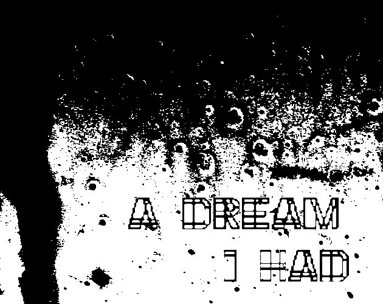
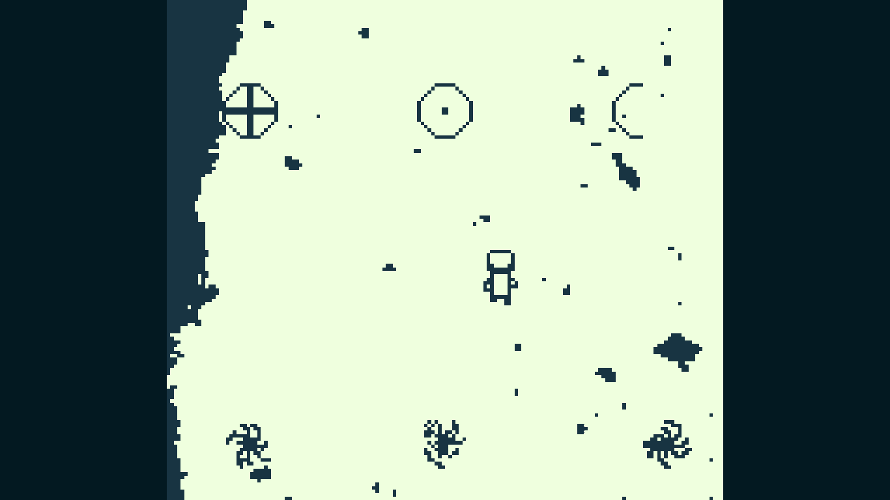
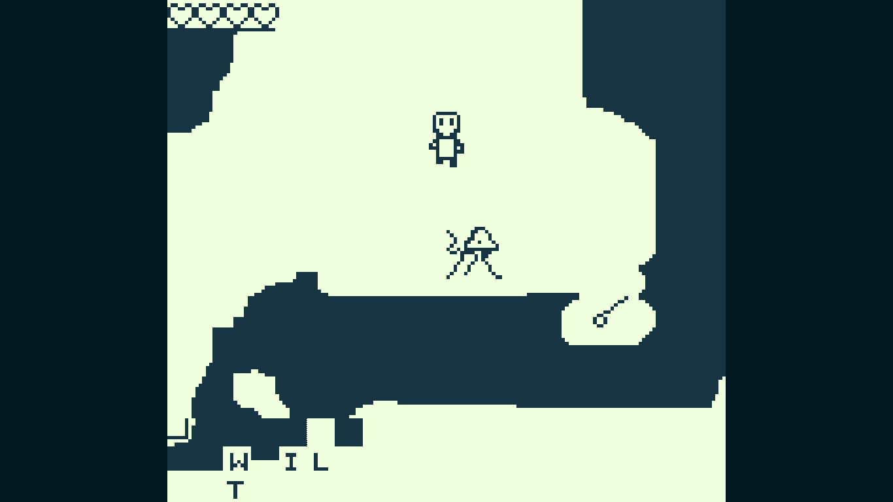

# A DREAM I HAD

**A DREAM I HAD** is a 1-Bit style GameBoy game inspired by Jungian archetypes, tarot, and astrology, featuring grotesque characters in a brutalist setting.

The game can be played in browser or downloaded as a ROM, and it was tested on original Game Boy hardware and emulators.

## About

You begin as the Fool and progress by exploring a strange world populated by manifestations of the Self. Some encounters are harmless, while others are more dangerous.

The game exploits graphical glitches and surreal map design to reflect the subconscious and dreamlike structure of the experience.

## Play

Play the game here:

[A DREAM I HAD on itch.io](https://jqrsound.itch.io/a-dream-i-had)

## Features

- 1-Bit visual style.
- GameBoy-compatible design.
- Browser play support.
- Downloadable ROM.
- Surreal dream-inspired atmosphere.
- Tarot and archetype themes.

## Controls

Use the standard GameBoy controls or the controls provided by your emulator or browser. 

- Up : arrow up
- Down : arrow down
- Left : arrow left
- Right : arrow right
- A (Action) : z
- B (Return/Attack) : x
- Start (Quit) : Enter
- Select (Menu) : Shift

## Screenshots

  

  

  

  

  

  Made with ❤️ in [GB Studio](https://www.gbstudio.dev)

