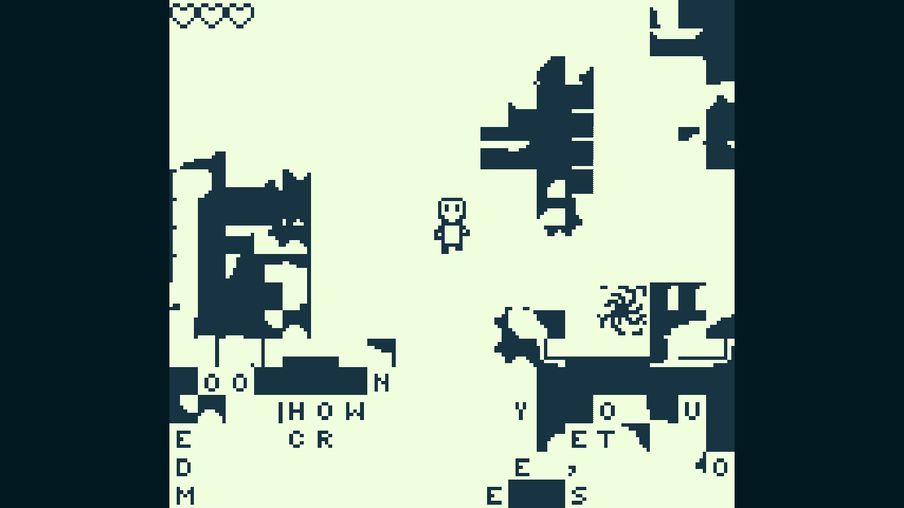

# A DREAM I HAD

**A DREAM I HAD** is a 1‑bit style Game Boy game inspired by Jungian archetypes, tarot, and astrology, featuring grotesque characters in a brutalist setting.

It’s a top‑down 2D exploration game with some action. It can be played in a browser or downloaded as a ROM.  
It has been tested on original Game Boy hardware and on emulators.

## About

You begin as the Fool and progress by exploring a strange world populated by manifestations of the Self. Some encounters are harmless; others are more dangerous.

The game exploits memory‑management bugs in GB Studio 2.0.0.0‑beta4 to create surreal maps, designed with graphical glitches to reflect the subconscious and dreamlike structure of the experience.

## Play

Play the game online here:

[A DREAM I HAD on itch.io](https://jqrsound.itch.io/a-dream-i-had)

Or download the ROM from [/extra](https://github.com/jqrsound/ADreamIHad/tree/main/extra) and play it on an original Game Boy or a Game Boy emulator.

## Features

- 1‑bit visual style.  
- Game Boy–compatible design.  
- Browser play support.  
- Downloadable ROM.  
- Surreal, dream‑inspired atmosphere.  
- Tarot and archetype themes.

## Controls

Use standard Game Boy controls, or the controls provided by your emulator or browser.

- Up: Arrow Up  
- Down: Arrow Down  
- Left: Arrow Left  
- Right: Arrow Right  
- A (Action): Z  
- B (Return / Attack): X  
- Start (Quit): Enter  
- Select (Menu): Shift

## Screenshots

  

  

  

  

## Extra

Along with the Game Boy ROM, you can also download a tarot deck inspired by the game, plus two booklets.

1. **ADreamIHad_Tarot_A4.pdf**

   Use this file to print your deck in black and white (front and back) on white cardboard (minimum 220 g).

2. **ADreamIHad_Tarot_Booklet.pdf**

   This file contains guidelines and reading examples.

3. **ADreamIHad_Game_Booklet.pdf**

   This file contains the main instructions and some extra help for solving the game.

 

  Made with ❤️ in GB Studio

